<!--
  Every animated image here is generated, script-free SVG:
    python3 tools/build_assets.py           # rebuild assets/*.svg after editing tools/build_assets.py
    python3 -m unittest discover -s tools   # tests (incl. "assets are up to date")
-->
<div align="center">



<a href="https://whiteccinn.github.io/"></a>
&nbsp;
<a href="mailto:471113744@qq.com"></a>

</div>

### `$ cat model_card.yaml`

```yaml
model:          ccinn                      # a.k.a. 白菜 🥬 · Wen-hui Cai
architecture:   full-stack engineer
specialization: [distributed storage, data pipelines, high-concurrency services]
languages:
  daily:  [Rust, Go, C, C++]
  native: PHP                              # still the sharpest tool in my box
training_data:                             # things I've built in the open
  - the Kafka protocol, end to end         # kafka-swoole
  - git hooks for PHP                      # husky-php
  - a distributed 64-bit ID issuer         # IdCenterSender
  - Flink SQL tooling                      # flink-sql-submit
motto: "To know but not to do is not to know."   # 知道做不到，等于不知道
```

### `$ ccinn.forward()`



### `$ stackmon`



### `$ ls ~/repos --sort=stars`

<a href="https://github.com/whiteCcinn/husky-php"></a>
<a href="https://github.com/whiteCcinn/kafka-swoole"></a>
<a href="https://github.com/whiteCcinn/swoole-yaf-better"></a>
<a href="https://github.com/whiteCcinn/IdCenterSender"></a>
<a href="https://github.com/whiteCcinn/daemon"></a>
<a href="https://github.com/whiteCcinn/flink-sql-submit"></a>

<br />


<div align="center"><sub><code>知道做不到，等于不知道</code> · to know but not to do is not to know</sub></div>
